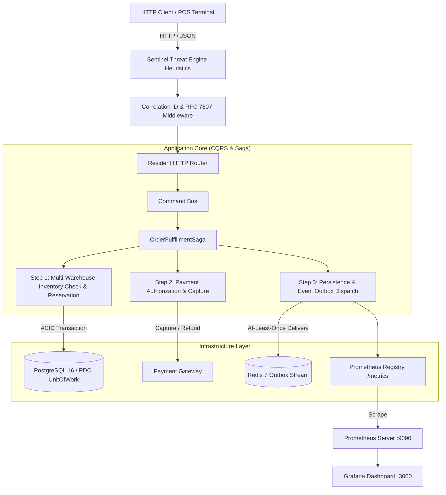

# 🛒 Ferrox-PHP Enterprise E-Shop Microservice

[](https://php.net)
[](https://frankenphp.dev)
[](#architecture)
[](http://localhost:9090)

The **Ferrox Enterprise E-Shop** is the production-grade reference microservice of the Ferrox PHP ecosystem. It transforms traditional PHP from a request-bound shared-nothing script into a persistent, memory-resident microservice capable of sub-millisecond execution, distributed ACID orchestration, and multi-warehouse compensation.

---

## 🏛️ Architecture Overview



### Key Enterprise Patterns
1. **Multi-Warehouse SAGA with Reverse Compensation**: Checks warehouses in geographical order (e.g., Rome Hub -> Milan Central -> Naples). If a warehouse is out of stock, it falls back seamlessly. If total stock is depleted or payment fails, it rolls back all reservations and triggers customer refund events.
2. **ACID UnitOfWork**: Transactions are coordinated through `PostgreSqlUnitOfWork`, enforcing read-after-write master routing and atomic state transitions.
3. **Outbox Pattern**: Domain events (`OrderFulfilledEvent`, `OrderRefundedEvent`, `StockDepletedEvent`) are atomically written and reliably flushed to Redis.
4. **Resident Memory Lifecycle**: Bypasses PHP-FPM overhead using FrankenPHP or Swoole worker modes, maintaining AST caches and persistent DB connections.
5. **Zero-Trust Security**: WAF Shannon entropy detection, PASETO v4 token enforcement, and RFC 7807 structured problem responses.

---

## 🚀 Quickstart & Deployment

### Option A: Docker Compose (Full Stack)
Spin up the E-Shop microservice alongside PostgreSQL 16, Redis 7, Prometheus, and Grafana:

```bash
cd examples/eshop
docker-compose up --build -d
```

Services exposed:
| Service | Endpoint | Credentials / Details |
|---|---|---|
| **E-Shop API** | `http://localhost:8080` | High-performance FrankenPHP |
| **Prometheus** | `http://localhost:9090` | Scraping `/metrics` every 5s |
| **Grafana** | `http://localhost:3000` | User: `admin` / Password: `ferrox_admin` |
| **PostgreSQL** | `localhost:5432` | DB: `ferrox_eshop`, User: `ferrox`, Pass: `ferrox_secret` |
| **Redis** | `localhost:6379` | Outbox buffer and cache |

### Option B: Local PHP Runner
```bash
# Run resident memory server in CLI simulation mode
php examples/eshop/bin/server.php
```

---

## ⚙️ Environment Configuration (`.env`)

Copy `.env.example` to `.env`:

```ini
APP_ENV=development
PORT=8080

# PostgreSQL 16
DATABASE_URL=pgsql:host=localhost;port=5432;dbname=ferrox_eshop
DB_USER=ferrox
DB_PASSWORD=ferrox_secret

# Redis 7 (Outbox & Cache)
REDIS_HOST=localhost
REDIS_PORT=6379

# Cryptography & Security
PASETO_V4_LOCAL_KEY=707172737475767778797a7b7c7d7e7f808182838485868788898a8b8c8d8e8f
SENTINEL_WAF_STRICT_MODE=true

# Observability
METRICS_ENABLED=true
```

---

## 📡 API Reference & `curl` Examples

### 1. Healthcheck Probes
```bash
# Liveness Probe
curl -i -X GET http://localhost:8080/health/live

# Readiness Probe
curl -i -X GET http://localhost:8080/health/ready
```

### 2. Inspect Warehouse Stock
```bash
curl -i -X GET http://localhost:8080/api/v1/warehouses
```

### 3. Submit an Order (Triggers Multi-Warehouse Fallback)
```bash
# Rome has 0 units of PROD-1, Milan has 8. The Saga allocates from Milan:
curl -i -X POST http://localhost:8080/api/v1/orders \
  -H "Content-Type: application/json" \
  -d '{
    "productId": "PROD-1",
    "quantity": 2,
    "customerId": "CUST-ROME-99",
    "source": "ONLINE",
    "unitPriceCents": 2999,
    "currency": "EUR"
  }'
```

### 4. Trigger Out-Of-Stock Compensation (RFC 7807 Error)
```bash
# Requesting 100 units exceeds total global inventory:
curl -i -X POST http://localhost:8080/api/v1/orders \
  -H "Content-Type: application/json" \
  -d '{
    "productId": "PROD-1",
    "quantity": 100,
    "customerId": "CUST-OVERFLOW",
    "source": "ONLINE",
    "unitPriceCents": 2999,
    "currency": "EUR"
  }'
```

### 5. Synchronize Offline POS Batch
```bash
curl -i -X POST http://localhost:8080/api/v1/pos/batch \
  -H "Content-Type: application/json" \
  -d '{
    "posTerminalId": "POS-TERM-MILAN-04",
    "orders": [
      {"productId": "PROD-2", "quantity": 1, "customerId": "POS-WALKIN-1", "unitPriceCents": 999},
      {"productId": "PROD-2", "quantity": 2, "customerId": "POS-WALKIN-2", "unitPriceCents": 999}
    ]
  }'
```

### 6. Prometheus Observability Metrics
```bash
curl -i -X GET http://localhost:8080/metrics
```

---

## 🧪 Automated Testing

Run the test suite covering domain invariants, DTO validation, and Saga end-to-end rollbacks:

```bash
# Run unit & E2E tests
vendor/bin/phpunit examples/eshop/tests
```
